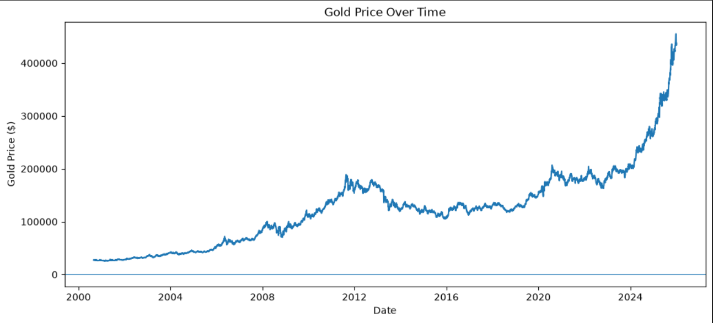
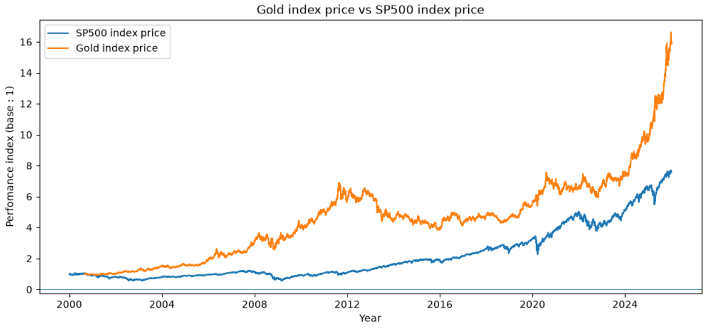
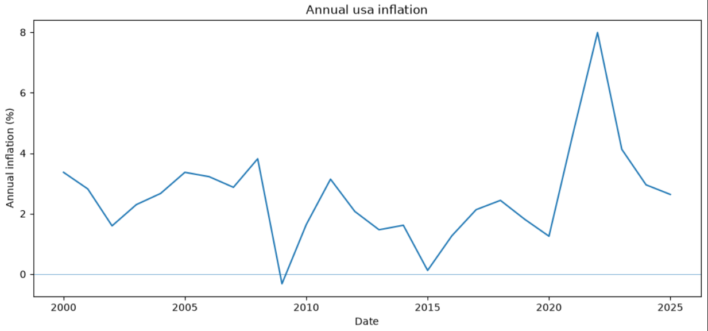

# Gold vs S&P 500

## Objective

Analyze the long-term performance of gold compared with the S&P 500.

## Data

- Gold: Yahoo Finance (GC=F)
- S&P 500: Yahoo Finance
- Period: 2000–2025

## Methodology

We compare normalized prices and cumulative returns.

## Main results

## Gold futurs contracts prices over time

## Gold vs s&p500

The normalized index shows that gold outperformed the S&P 500 over the entire period since 2000.

Thus, for every $1 invested in gold in 2000, you would have had approximately $16 by the end of 2025. In contrast, for every $1 invested in the S&P 500, you would have had approximately $8 by the end of 2025.

## USA inflation

